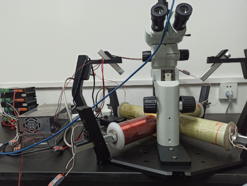
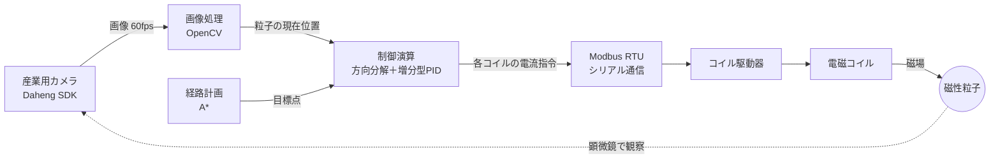
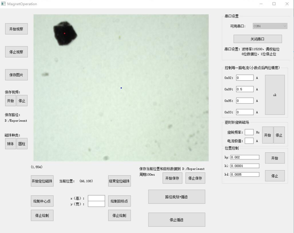
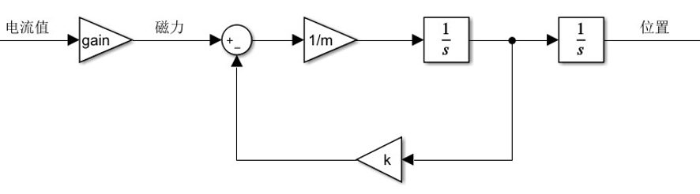
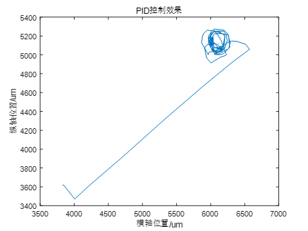
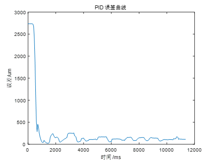
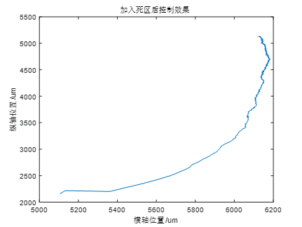
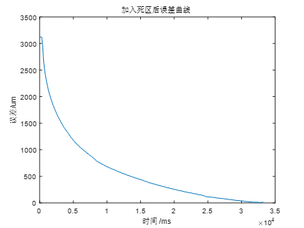
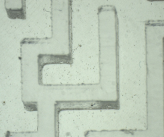
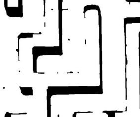

# MagnetOperation

**磁場駆動マイクロロボットの視覚フィードバック制御ソフトウェア**（学部卒業研究・2022年）

顕微鏡カメラの画像から磁性マイクロ粒子（磁珠）の位置を検出し、電磁コイルの電流をリアルタイムに制御することで、粒子を目標位置まで移動させる上位機ソフトウェアです。
画像認識・経路計画・フィードバック制御・駆動器との通信までを一つのアプリケーションとして個人で設計・実装しました。

*実験装置：実体顕微鏡＋産業用カメラ（上方）、周囲に配置した電磁コイル、コイル駆動器（左奥）*

---

## システム構成

| 項目 | 内容 |
|---|---|
| 言語・フレームワーク | C++ / Qt 5.13（GUI、Qt SerialBus、シグナル・スロット） |
| 画像処理 | OpenCV（二値化、輪郭抽出、最小外接円・回転矩形による粒子検出） |
| カメラ | Daheng 産業用カメラ SDK をラップした独自カメラインターフェース |
| 通信 | Modbus RTU（115200bps、偶数パリティ）による駆動器への電流書き込み |
| 対応コイル構成 | 平面4極コイル／ヘルムホルツコイル／OctoMag 型（起動時に選択） |
| 開発環境 | Windows、Visual Studio |

## 主な機能

- **観察・記録**：Qt ウィジェットに OpenCV 画像を埋め込み、リアルタイム表示。画像・動画（60fps）と位置ログの保存
- **粒子検出**：球体／円柱の形状選択に応じて、最小外接円または回転矩形で位置を算出
- **手動制御**：各コイルの電流値の直接入力、回転磁場（周波数・振幅を指定）の生成
- **位置制御**：画面上でクリックした目標点へ自動移動（制御周期 50ms、PID パラメータを GUI で調整可能）
- **経路計画と追従**：迷路画像から A* で経路を求め、経路点を順に追従

## 制御手法

### 制御対象のモデル

コイル電流から粒子位置までを、「電流に比例する磁力」と「流体の粘性抵抗」をもつ2階系として扱いました。

$$ m\ddot{x} = g \cdot I - k\dot{x} $$

### 方向分解と増分型 PID

1. 画像上で各コイルが粒子を引く方向をあらかじめ校正しておく
2. 現在位置から目標位置への誤差ベクトルを、隣り合う2つのコイル方向の成分に**正弦定理**で分解する
3. 各コイルについて**増分型 PID** で電流指令を計算し、**飽和処理**（±3A）を行う
4. 目標近傍では**不感帯**を設け、向きを保つ最小限の電流に切り替えて振動を抑える

## 実験結果

### PID のみの場合

約1秒で誤差は 2,700µm から数百µm まで減少しますが、目標付近で粒子が周回し、100〜200µm 程度の残留振動が残りました。

| 軌跡 | 誤差の推移 |
|---|---|
|  |  |

### 不感帯を追加した場合

収束に時間はかかるものの、オーバーシュートなく単調に目標へ近づき、最終的な誤差はほぼ 0 になりました。

| 軌跡 | 誤差の推移 |
|---|---|
|  |  |

### 迷路環境での経路計画

迷路の顕微鏡画像を二値化して通行可能領域を抽出し、A* による経路計画に用いました。

| 原画像 | 二値化後 |
|---|---|
|  |  |

## 開発で直面した課題と対応

コミット履歴に試行錯誤の過程を記録しています。主なものは次のとおりです。

| 課題 | 対応 |
|---|---|
| 画像処理（60fps）に対して駆動器の通信が追いつかず、指令が溜まって遅延が増大した | 制御を画像更新から切り離し、タイマーで一定周期（50ms）に実行するよう変更 |
| 複数コイルを同時に使うと粒子が回転せず振動するだけだった | 磁力計で各コイルが中心部に作る磁場の向きをそろえるよう校正 |
| 動画保存時にフレームレートが 18fps 程度に低下した | 保存解像度を 612×512 に縮小し、60fps での保存を実現 |
| 積分飽和対策（遇限削弱積分）が、粒子の向きが変わる場面ではうまく機能しなかった | 目標近傍での不感帯制御に方針を変更 |
| シリアル通信で書き込み失敗や応答タイムアウトが発生した | 駆動器向け通信処理を書き直し、Qt のバージョン変更（5.12.7→5.13.2）で暫定的に解消 |

## ファイル構成

| ファイル | 役割 |
|---|---|
| `MainInterface.*` | メインウィンドウ、各サブウィンドウ間の信号接続 |
| `ImageDisplay.*` / `ImageProcessing.*` | 画像表示・保存、粒子検出、迷路の二値化 |
| `Cam.*` / `DahengDriver.*` | カメラインターフェースと Daheng カメラ実装 |
| `Control.*` | 方向分解、増分型 PID、飽和・不感帯処理 |
| `Astar.*` | A* 経路計画 |
| `SerialPortCommunication.*` | Modbus RTU による駆動器の読み書き |
| `Debug_Pole.*` / `Debug_Helmholtz.*` | 4極コイル／ヘルムホルツコイル用の操作画面（回転磁場の生成を含む） |

## 補足

- 2022年当時のコードをそのまま公開しています。
- ソースコード中のコメントは中国語（GBK エンコード）のため、GitHub 上では文字化けして表示される場合があります。
- 実行には Daheng カメラ SDK と実験装置（コイル・駆動器）が必要です。
